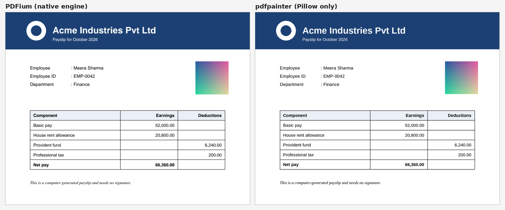

# pdfpainter

**Paint PDF pages to images with Pillow alone: no native PDF engine, Apache-2.0 licensed, text in exactly the right place.**

```python
import pdfpainter

img = pdfpainter.render_pdf("payslip.pdf", page=0, dpi=150)   # a Pillow image
img.save("payslip-1.png")
```



## Why pdfpainter

Most ways to turn a PDF page into an image load a native engine: MuPDF, PDFium, Poppler or Ghostscript. That fails where policies block unsigned DLLs (Windows Application Control on government and bank PCs, locked-down servers), and some of those engines are AGPL or GPL.

pdfpainter paints pages with **Pillow and NumPy only**, from what [pdfsieve](https://github.com/Vibhu1712/pdfsieve) reads with pure-Python pdfminer.six. It is built for two jobs:

1. **OCR** of pages with no usable text layer: scans, and text drawn as outlines (for example PDFs from "Microsoft Print to PDF"). Letter outlines are filled with their holes, so OCR  reads them.
2. **Showing a page on screen** so users can see it, click on it, or drag boxes over it. Words land in exactly the positions the PDF gives them.

It is **not** a full PDF renderer; see [what is drawn](#what-is-drawn-and-what-isnt). For pixel-perfect output, use PDFium (pypdfium2) when it's available and fall back to pdfpainter when it isn't. The two produce images of the same size, so they're interchangeable.

## Contents

- [Install](#install)
- [Quick start](#quick-start)
- [Command line](#command-line)
- [API reference](#api-reference)
- [Recipes](#recipes)
- [What is drawn, and what isn't](#what-is-drawn-and-what-isnt)
- [Fonts](#fonts)
- [Speed](#speed)
- [Development](#development)
- [Licence](#licence)

## Install

```bash
pip install pdfpainter
```

Python 3.9 or newer. Installs pdfsieve, pdfminer.six, Pillow and NumPy, all with permissive licences and wheels for every common platform.

## Quick start

```python
import pdfpainter
import pdfsieve

# one call: open, paint, close
img = pdfpainter.render_pdf("statement.pdf", page=0, dpi=200)

# or paint pages you already opened with pdfsieve
with pdfsieve.open("statement.pdf") as doc:
    for page in doc:
        img = pdfpainter.render(page, zoom=2.0)          # 2 pixels per point = 144 dpi
        img.save(f"statement-{page.index + 1}.png")

# find out what couldn't be drawn
info = {}
img = pdfpainter.render_pdf("scan.pdf", dpi=300, info=info)
print(info)   # {'undecoded': 0, 'skipped_fills': 0}
```

**Zoom and dpi.** `zoom` is pixels per PDF point; `dpi = zoom × 72`. A word box from pdfsieve maps onto the image by multiplying each coordinate by `zoom`.

## Command line

```bash
pdfpainter payslip.pdf                         # every page to payslip-1.png, payslip-2.png, ...
pdfpainter payslip.pdf -o page.png -p 1        # one page
pdfpainter payslip.pdf -o "out/p{page}.jpg"    # {page} is the page number; extension picks the format
pdfpainter payslip.pdf --dpi 300               # default 150
pdfpainter payslip.pdf --no-text               # shapes and images only
pdfpainter locked.pdf --password secret
```

Each file written is listed with its size, plus a note if something on the page couldn't be shown:

```
k-1.png  (417 x 417)  note: 1 image(s) in an unsupported format shown as grey boxes
```

## API reference

### `render(page, zoom=1.0, info=None, *, dpi=None, background=(255, 255, 255), text=True, antialias=True)`

Paint a `pdfsieve.Page` and return an RGB `PIL.Image.Image`.

| Argument | Meaning |
|---|---|
| `page` | A page from `pdfsieve.open(...).page(i)`. |
| `zoom` | Pixels per point. `1.0` is 72 dpi. |
| `dpi` | Alternative to `zoom`: dots per inch. |
| `info` | A dict to receive `undecoded` (images in an unsupported format, drawn as grey boxes)  and `skipped_fills` (shapes filled with a pattern or shading, left out). |
| `background` | Page colour. |
| `text` | `False` leaves the text layer out, to see what a page looks like without it. |
| `antialias` | Paint vector content at twice the size, then shrink, for smooth edges. Turn off for speed. |

The image size is `ceil(width × zoom) × ceil(height × zoom)`, the same rounding PDFium uses
(see `page_size_px(page, zoom)`).

### `render_pdf(source, page=0, zoom=1.0, *, dpi=None, password="", info=None, **kwargs)`

Open a PDF (path, bytes or binary file object), paint one page (0-based), and close it. Other
keyword arguments go to `render`.

### `decode_image(stream) -> (image or None, is_stencil)`

Decode one embedded image (a pdfminer stream, e.g. `page.pictures[0].stream`) into a Pillow image,
for extracting a scan's image without rendering the whole page. Returns `(None, False)` for
unsupported formats.

### Fonts

| | |
|---|---|
| `add_font_dir(path)` | Search a folder for fonts before the system folders. |
| `font_dirs()` | The folders searched, in order. |
| `find_font(family, bold, italic=False)` | Path of the font used for `"sans"`, `"serif"`, `"mono"`, `"indic"` or `"cjk"`. |
| `font_for(pdf_font_name, char, px)` | The Pillow font used to draw a character. |
| `FAMILIES`, `ITALICS` | The candidate font file names per family; edit to prefer other fonts. |

The `PDFPAINTER_FONT_DIRS` environment variable adds folders too (separated by `;` on Windows and
`:` elsewhere).

### Other

| | |
|---|---|
| `page_size_px(page, zoom)` | Size in pixels `render` will produce. |
| `to_ppm(img)` | PPM bytes that Tkinter's `PhotoImage(data=...)` shows with no extra libraries. |
| `MAX_PIXELS` | Above this canvas size, `antialias` is skipped to save memory. |

## Recipes

Runnable versions live in [`examples/`](examples). Make the sample PDF with
`python examples/make_sample_pdf.py` (needs `pip install reportlab`).

### OCR a page that has no text layer

```python
import numpy as np
import pdfpainter, pdfsieve
from rapidocr import RapidOCR        # pip install rapidocr onnxruntime

zoom = 300 / 72
with pdfsieve.open("printed-to-pdf.pdf") as doc:
    img = pdfpainter.render(doc.page(0), zoom)

result = RapidOCR()(np.asarray(img))
for quad, text in zip(result.boxes, result.txts):
    xs, ys = [p[0] for p in quad], [p[1] for p in quad]
    print(min(xs) / zoom, min(ys) / zoom, text)    # back in PDF points, like pdfsieve's words
```

[`examples/ocr_page.py`](examples/ocr_page.py) does the same with RapidOCR or, if that isn't
installed, Tesseract.

### Draw word boxes over the page

```python
from PIL import ImageDraw

zoom = 2.0
with pdfsieve.open("sample.pdf") as doc:
    page = doc.page(0)
    img = pdfpainter.render(page, zoom)
    draw = ImageDraw.Draw(img)
    for w in page.words():
        draw.rectangle([v * zoom for v in w[:4]], outline="red", width=2)
img.save("boxes.png")
```

### PDFium when allowed, pdfpainter when not

```python
def page_image(path, index, zoom):
    try:
        import pypdfium2 as pdfium
        pdf = pdfium.PdfDocument(path)
        try:
            return pdf[index].render(scale=zoom).to_pil().convert("RGB")
        finally:
            pdf.close()
    except Exception:                 # not installed, or its DLL is blocked
        return pdfpainter.render_pdf(path, index, zoom)
```

### Show a page in Tkinter with no extra libraries

```python
import tkinter as tk

root = tk.Tk()
photo = tk.PhotoImage(data=pdfpainter.to_ppm(pdfpainter.render_pdf("sample.pdf", dpi=96)))
tk.Label(root, image=photo).pack()
root.mainloop()
```

### Pull the scanned image out of a page

```python
with pdfsieve.open("scan.pdf") as doc:
    pic = doc.page(0).pictures[0]
    img, is_stencil = pdfpainter.decode_image(pic.stream)
    if img is not None:
        img.save("scan.png")          # at the scan's own resolution
```

## What is drawn, and what isn't

**Drawn**

- Filled and stroked paths, with curves, line widths and colours (gray, RGB, CMYK, spot tints).
- Holes in shapes under both fill rules, so letters drawn as outlines (`o`, `e`, `8`) keep their
  counters and OCR reads them.
- Embedded images, upright or rotated: JPEG, JPEG 2000 (if your Pillow reads it), and raw, Flate,
  LZW or RunLength data in gray, RGB, CMYK, ICC, calibrated and indexed colour spaces at
  1–16 bits; 1-bit stencil masks in the current fill colour.
- Real text in a similar system font (sans, serif or mono, bold and italic, Indic and CJK
  scripts), on its exact baseline, including sideways and upside-down text. Invisible text, such
  as a scan's OCR layer, is not drawn.

**Not drawn**

- Clipping paths: content outside a clip still shows.
- Transparency and blend modes: everything is opaque.
- Pattern and shading fills (gradients): left out and counted in `info["skipped_fills"]`.
- Dashed lines are drawn solid; line caps and joins are approximated.
- The PDF's own embedded fonts: text is set in a system font, so letter shapes and widths differ
  slightly, though each character starts where the PDF puts it.
- JBIG2 images (common in scanned archives) and unusual colour spaces (DeviceN, Lab images): drawn
  as grey boxes and counted in `info["undecoded"]`.
- Annotations and form-field appearances.

## Fonts

Text is set in fonts already on the computer:

| Family | Windows | macOS | Linux |
|---|---|---|---|
| sans | Arial, Segoe UI | Arial | Liberation Sans, DejaVu Sans, FreeSans |
| serif | Times New Roman | Times New Roman | Liberation Serif, DejaVu Serif, FreeSerif |
| mono | Courier New | Courier New | Liberation Mono, DejaVu Sans Mono, FreeMono |
| indic | Nirmala UI, Mangal | Kohinoor | Noto Sans Devanagari |
| cjk | Yu Gothic, MS Gothic, Microsoft YaHei, Malgun Gothic | PingFang | Noto Sans CJK |

The family is chosen from the PDF's font name (`Times`, `Courier`, `Bold`, `Italic`, ...) and the
character's script. With no matching font installed, Pillow's built-in font is used. On a minimal
Linux server, `apt install fonts-liberation` gives good results.

## Speed

In testing, painting at 150 dpi took about **100–200 ms per page**, on top of pdfsieve's reading
time; text-heavy pages take longest. Turning off `antialias` cut that to **20–130 ms**, at the
cost of rougher edges. For OCR, antialiasing usually helps accuracy, so keep it on there.

## Development

```bash
git clone https://github.com/Vibhu1712/pdfpainter
cd pdfpainter
pip install -e ".[test]"
pytest
```

The tests build their sample PDFs at run time (with reportlab, plus a few hand-written PDFs for
image formats), and compare page sizes against PDFium when pypdfium2 is installed.

## Licence

Apache License 2.0; see [LICENSE](LICENSE). Copyright 2026 Vaibhav Rawat (AdRaw App Studio).
Dependencies and their licences are listed in [THIRD_PARTY_NOTICES.md](THIRD_PARTY_NOTICES.md).

pdfpainter began as the fallback page painter inside **docextract by AdRaw App Studio**, an
offline PDF-to-Excel extraction tool, and is published so others can use it too.
